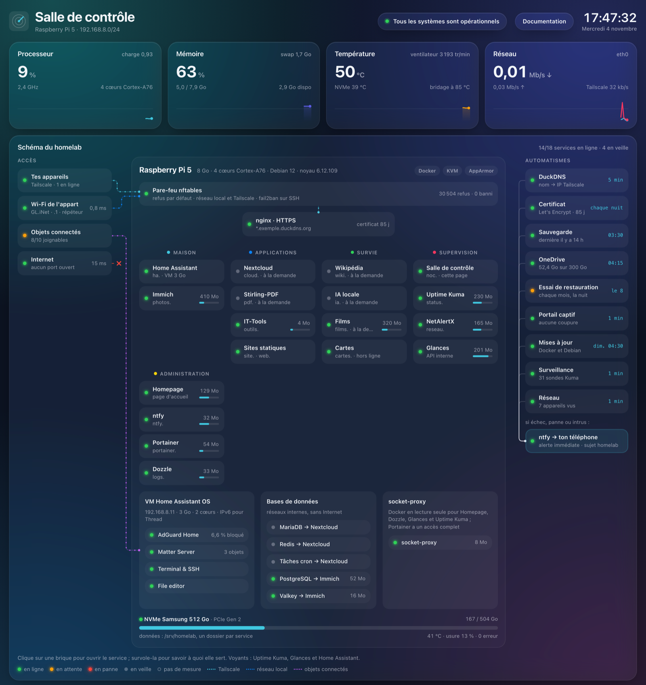
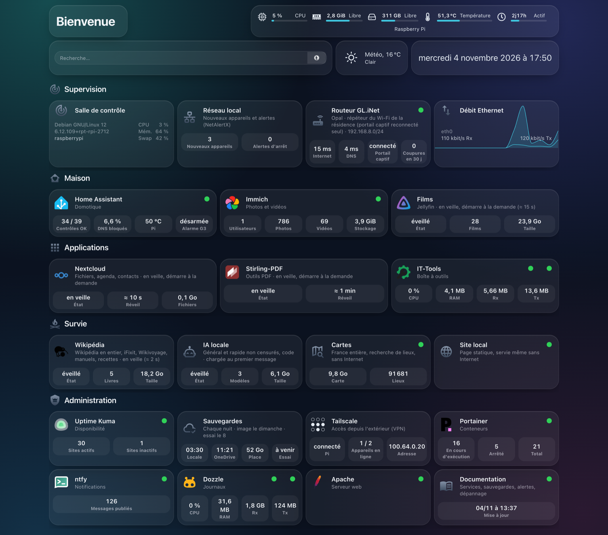
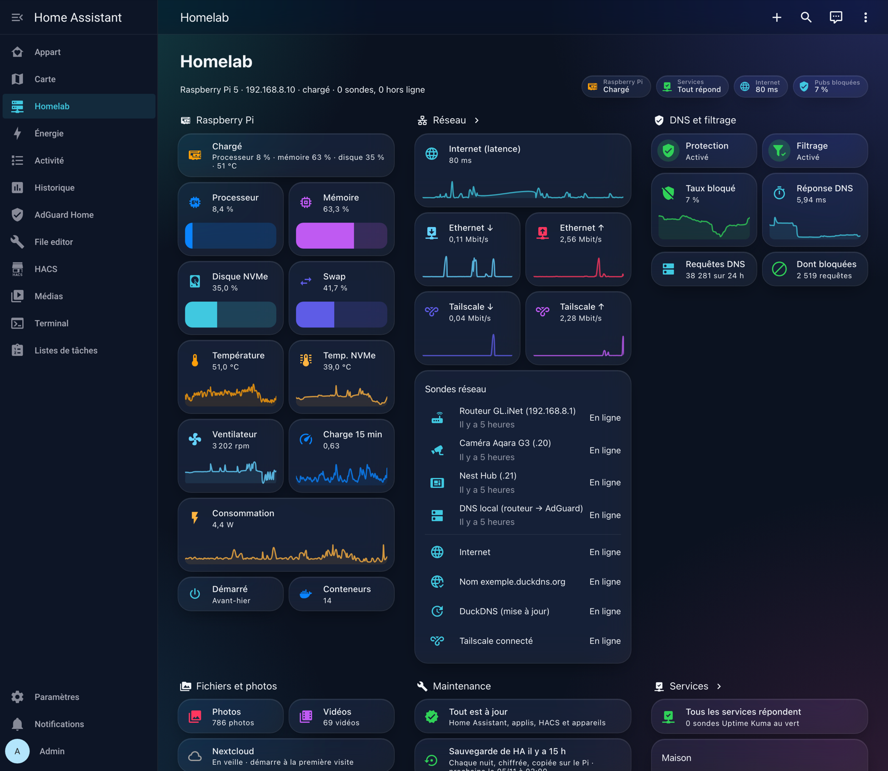
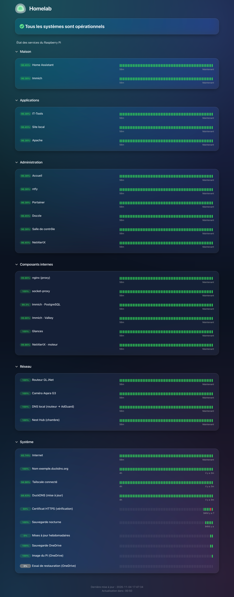
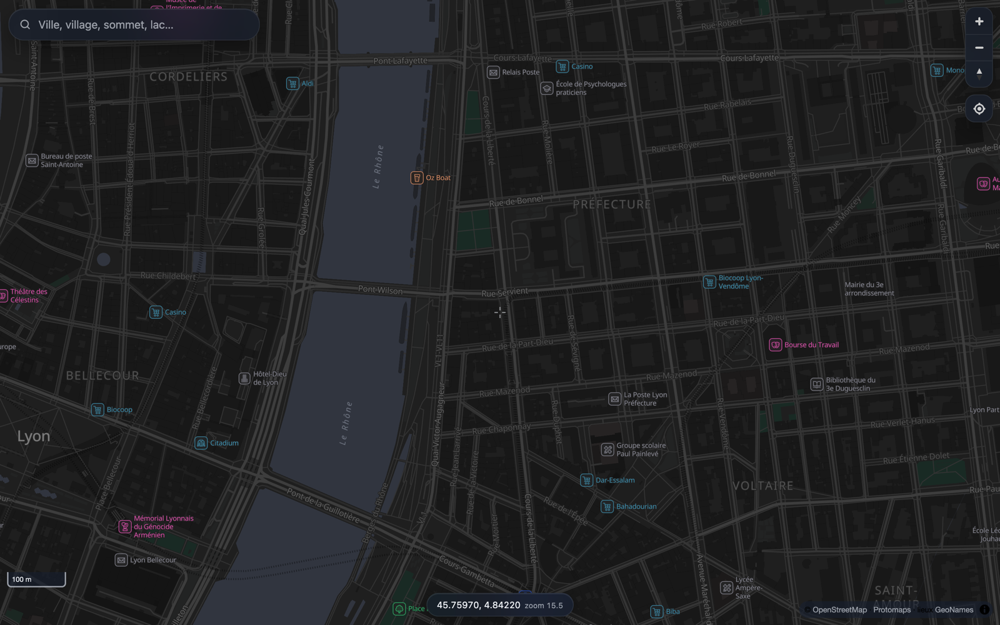
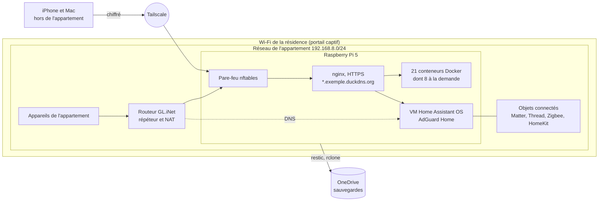

# Homelab

Mon serveur personnel : un Raspberry Pi 5 installé dans mon appartement étudiant. Il fait tourner ma domotique, mes photos, un DNS filtrant pour tout l'appartement, de la supervision et des sauvegardes, avec un accès à distance sans aucun port ouvert sur Internet.

Je suis étudiant en informatique et je m'intéresse aux serveurs et à la domotique depuis longtemps. Le réseau, l'administration système et la sécurité ne font pas partie de mes cours, je les apprends avec ce projet. Le homelab actuel est le résultat de plusieurs années de travail et d'apprentissage, avec beaucoup de bugs en route. J'ai utilisé l'IA pour avancer plus vite et apprendre en autodidacte (voir [docs/methode.md](docs/methode.md)).

L'appartement est dans une résidence étudiante. Internet arrive par le Wi-Fi de la résidence, partagé avec les autres résidents et protégé par un portail captif qui coupe la connexion quand la session expire. Je n'ai la main ni sur la box ni sur le pare-feu, donc impossible d'ouvrir un port. Tout tourne sur un seul Raspberry Pi, et je voulais un système capable de tenir longtemps sans que j'aie à le surveiller tous les jours. Plus de détails dans [docs/contexte.md](docs/contexte.md).

Les fichiers de ce dépôt sont ceux de mon installation, adaptés à mon réseau et à mon matériel.

## Fonctionnalités

- Accès à distance par Tailscale, sans port ouvert, et HTTPS partout avec un certificat Let's Encrypt générique.
- AdGuard Home comme DNS de tout l'appartement : publicités et pistage bloqués, DNS chiffré, DNSSEC.
- Home Assistant OS dans une machine virtuelle, avec des objets Matter, Thread, Zigbee et HomeKit.
- Services peu utilisés démarrés seulement quand on les ouvre.
- 31 sondes Uptime Kuma, une page de supervision faite maison et l'inventaire des appareils du réseau.
- Alertes sur le téléphone avec ntfy, en deux niveaux (critique ou silencieux).
- Sauvegarde locale et copie chiffrée hors site chaque nuit, image du disque chaque semaine, essai de restauration automatique chaque mois.
- Reconnexion automatique au portail captif de la résidence.
- Wikipédia, une IA locale et la carte de France utilisables sans Internet.
- Système durci, score Lynis passé de 70 à 81.

## Captures

| | |
|---|---|
|  |  |
| Page d'accueil (Homepage), avec les capteurs de chaque service. | Tableau « Homelab » dans Home Assistant. |
|  |  |
| Page de statut d'Uptime Kuma. | Carte de France hors ligne (OpenStreetMap, Protomaps). |

Le domaine, les noms, les adresses publiques et les identifiants matériels ont été remplacés sur les captures.

## Matériel

| Élément | Modèle | Rôle |
|---|---|---|
| Serveur | Raspberry Pi 5, 8 Go, refroidissement actif | Conteneurs, machine virtuelle, sauvegardes |
| Stockage | SSD NVMe Samsung PM981 512 Go (`MZVLB512HBJQ`), en PCIe Gen 2 | Système et données, sans carte SD |
| Routeur | GL.iNet Opal `GL-SFT1200` | Répète le Wi-Fi de la résidence et crée le réseau de l'appartement |
| Domotique | Aqara Camera Hub G3, capteur FP2, Nest Hub, prise Meross, objets IKEA et Tuya | Sécurité, présence, lumière, mesures |

Le Pi consomme environ 6 W. Plus de détails dans [docs/materiel.md](docs/materiel.md).

## Architecture

Aucune connexion n'arrive depuis Internet. Dans l'appartement, les appareils passent par le routeur ; à l'extérieur, par Tailscale. nginx est le seul point d'entrée vers les services, qui n'écoutent que sur le Pi. Plus de détails dans [docs/architecture.md](docs/architecture.md).

J'utilise quelques services externes, tous gratuits ou inclus dans mon compte étudiant : Tailscale pour l'accès à distance, DuckDNS pour le nom de domaine et la validation du certificat, Let's Encrypt, OneDrive pour les sauvegardes, ntfy.sh pour relayer les notifications vers l'iPhone, Quad9 et Cloudflare comme DNS en amont.

## Services

| Domaine | Services | Fonctionnement |
|---|---|---|
| Maison | Home Assistant, Immich (photos), Jellyfin (médiathèque) | Home Assistant en VM, Immich permanent, Jellyfin à la demande |
| Applications | Nextcloud, Stirling-PDF, IT-Tools | Nextcloud et Stirling-PDF à la demande |
| Hors ligne | Kiwix (Wikipédia), llama.cpp (IA locale), cartes | Kiwix et l'IA à la demande, les cartes sont un site statique |
| Supervision | Salle de contrôle, Uptime Kuma, NetAlertX, Glances, Homepage | Permanent |
| Administration | ntfy, Dozzle, Portainer, documentation | Permanent |
| Réseau | nginx, AdGuard Home, Tailscale, DuckDNS | Permanent |

Côté système : Raspberry Pi OS 64 bits (Debian 12), Docker Compose, KVM et libvirt, nftables, fail2ban, AppArmor, restic, rclone et Lynis. La liste complète avec les versions est dans [docs/services.md](docs/services.md).

## Organisation du dépôt

| Dossier | Contenu | Emplacement sur le Pi |
|---|---|---|
| [stacks/](stacks/) | Une stack Docker Compose par service, nginx, page d'accueil, salle de contrôle | `/opt/homelab/` |
| [scripts/](scripts/) | La commande `homelab` et les scripts de sauvegarde, supervision et maintenance | `/usr/local/sbin/` |
| [systemd/](systemd/) | Tâches planifiées et services à la demande | `/etc/systemd/system/` |
| [systeme/](systeme/) | Pare-feu, réglages du noyau et de SSH, profil Lynis | `/etc/` |
| [home-assistant/](home-assistant/) | Tableau de bord « Homelab » en YAML | `/config/` dans la VM |
| [docs/](docs/) | Documentation et décisions d'architecture | |
| [captures/](captures/) | Captures d'écran | |

Les mots de passe, jetons et clés sont générés sur le Pi et rangés dans `/etc/homelab/secrets/`, hors du dépôt (voir [SECURITY.md](SECURITY.md)).

## À faire

- [ ] DNS de secours sur le routeur, utilisé seulement si AdGuard ne répond pas.
- [ ] Home Assistant : bannissement après des échecs de connexion, double authentification.
- [ ] Arrêter Portainer, qui donne un accès complet à Docker et sert très peu.
- [ ] Une seconde destination pour les sauvegardes, indépendante du compte étudiant.
- [ ] Passer à Debian 13 en 2027, avant la fin du support de Debian 12 en juin 2028.
- [ ] Un onduleur si le compteur d'arrêts brutaux du SSD continue de monter.

## Licence

MIT, voir [LICENSE](LICENSE). Tout repose sur des projets libres, en particulier Home Assistant, Immich, Nextcloud, Uptime Kuma, Homepage, Glances, NetAlertX, ntfy, Kiwix, llama.cpp, Jellyfin, MapLibre, Protomaps, restic, rclone et Lynis.
