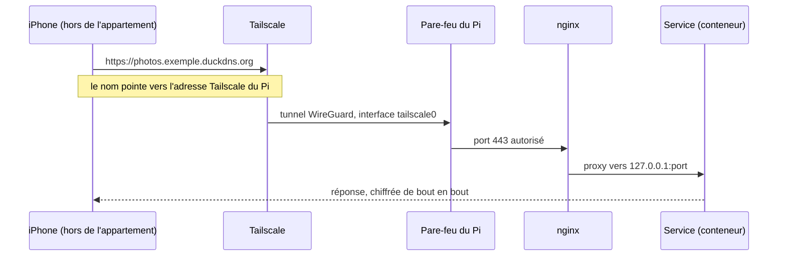

# Architecture

Une connexion traverse plusieurs couches avant d'arriver à un service :

| Couche | Rôle |
|---|---|
| Internet | Aucun port ouvert, ni à la résidence ni sur le routeur. |
| Tailscale | Seul chemin depuis l'extérieur, un réseau privé chiffré (WireGuard) entre mes appareils et le Pi. |
| Wi-Fi de la résidence | Réseau ouvert avec portail captif. Le routeur de l'appartement s'y connecte comme un client. |
| Routeur GL.iNet (`192.168.8.1`) | Crée le réseau de l'appartement et refuse ce qui arrive de la résidence. |
| Pare-feu du Pi (nftables) | Tout est refusé par défaut, sauf SSH, HTTP et HTTPS depuis le réseau local et Tailscale. La télé de mes parents n'a accès qu'à Jellyfin. |
| nginx | Point d'entrée unique vers les services, en HTTPS, avec un fichier de configuration par adresse. |
| Services | Conteneurs Docker liés à `127.0.0.1` et machine virtuelle Home Assistant. |
| SSD NVMe | Système, données, disque de la VM. |

Par exemple, quand j'ouvre mes photos depuis l'extérieur :



## Noms de domaine

Chaque service a une adresse du type `service.exemple.duckdns.org`, et un seul certificat Let's Encrypt générique (`*.exemple.duckdns.org`) les couvre toutes.

Le nom public pointe vers l'adresse Tailscale du Pi, donc hors de l'appartement il ne répond que sur un appareil connecté à Tailscale. Dans l'appartement, AdGuard Home répond avec l'adresse locale du Pi (`192.168.8.10`) et le trafic va directement au Pi. Pour la VM Home Assistant, AdGuard répond `10.99.0.1`, l'adresse du Pi sur le lien privé entre l'hôte et la VM.

Le certificat est validé par un défi DNS : Let's Encrypt vérifie un enregistrement TXT publié chez DuckDNS, ce qui marche sans aucun port ouvert. Voir l'[ADR 0004](adr/0004-nginx-seul-point-d-entree.md).

## Machine virtuelle Home Assistant

Home Assistant OS tourne dans une machine virtuelle KVM (libvirt) avec 3 Go de mémoire et 2 cœurs. Elle a une interface sur le réseau de l'appartement (`192.168.8.11`), nécessaire pour découvrir les objets et pour Matter et Thread, qui utilisent IPv6. Elle a aussi un lien privé avec le Pi (`10.99.0.0/24`), parce que son interface réseau ne peut pas joindre l'adresse locale de son propre hôte.

AdGuard Home tourne dans la VM, comme application de Home Assistant, et le routeur lui envoie toutes les requêtes DNS de l'appartement. Voir l'[ADR 0003](adr/0003-home-assistant-os-en-machine-virtuelle.md).

La mémoire se répartit à peu près ainsi : 3 Go réservés à la VM, environ 1,5 Go pour les conteneurs permanents (Immich 650 Mo, Uptime Kuma 220 Mo, Glances et NetAlertX 140 Mo chacun, Homepage 120 Mo, le reste sous 50 Mo). Les services à la demande ne prennent rien quand ils sont arrêtés, et de 50 Mo (Kiwix) à 3 Go (l'IA avec un modèle chargé) quand ils tournent. Chaque conteneur a une limite de mémoire et redémarre seul s'il plante.

## Fichiers sur le Pi

| Emplacement | Contenu |
|---|---|
| `/opt/homelab/<service>/compose.yaml` | Une stack Docker par service ([stacks/](../stacks/)) |
| `/srv/homelab/<service>/` | Les données de chaque service |
| `/etc/homelab/` | `homelab.env` (domaine, sauvegardes), `firewall.nft`, `secrets/` (lisible par root seulement) |
| `/usr/local/sbin/homelab*` | Les commandes du homelab ([scripts/](../scripts/)) |
| `/opt/homelab/proxy/templates/` | Un modèle nginx par adresse, rendu dans `conf.d/` avec le domaine par `homelab render` |
| `/var/backups/homelab/` | Sauvegardes locales des trois dernières nuits |
| `/var/lib/libvirt/images/` | Disque de la VM Home Assistant |

La commande `homelab` regroupe les opérations courantes :

```sh
homelab status          # état de tous les conteneurs
homelab up | down       # démarrer ou arrêter toutes les stacks
homelab maj             # mettre à jour les images (le dimanche à 04:30)
homelab render          # régénérer nginx et la page d'accueil depuis les modèles
homelab secrets         # créer les secrets manquants
```
