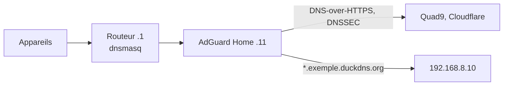

# Réseau

## Plan d'adressage

Le réseau de l'appartement est `192.168.8.0/24`. J'ai découpé les adresses en plages par usage, et chaque appareil fixe a une adresse réservée sur le routeur. La salle de contrôle signale un appareil qui n'est pas dans la bonne plage.

| Plage | Usage | Réservations |
|---|---|---|
| `.1` | Routeur | GL.iNet Opal |
| `.2` à `.9` | Infrastructure | libre |
| `.10` à `.19` | Serveurs | `.10` Raspberry Pi, `.11` VM Home Assistant (AdGuard) |
| `.20` à `.49` | Domotique | `.20` caméra G3, `.21` Nest Hub, `.22` passerelle Tuya, `.23` capteur FP2, `.24` prise Meross |
| `.50` à `.69` | Multimédia | libre |
| `.70` à `.99` | Appareils personnels | `.70` Mac, `.71` iPhone, `.72` Apple Watch |
| `.100` à `.199` | DHCP automatique | invités |
| `.200` à `.254` | Libre | |

Les appareils Apple utilisent une adresse Wi-Fi privée. Réglée sur « Fixe », elle ne change plus pour ce réseau, ce qui permet de la réserver. Le plan est aussi décrit dans [`plan.json`](../stacks/proxy/site/noc/plan.json), lu par la salle de contrôle ; je le garde synchronisé avec les réservations du routeur.

Le routeur diffuse le Wi-Fi de l'appartement en WPA2, uniquement en 2,4 GHz. Sa radio 5 GHz sert au lien avec la résidence, dont le point d'accès change de canal toutes les 10 minutes. Le routeur suit, et les appareils connectés en 5 GHz se reconnectaient à chaque fois. Le Nest Hub en faisait partie, et comme c'est lui qui relie le réseau Thread au reste de l'appartement, la lampe IKEA décrochait de Home Assistant. J'ai donc coupé le 5 GHz côté appartement.

## DNS



Le routeur transmet toutes les requêtes DNS à AdGuard Home, qui bloque publicités et pistage et interroge Quad9 et Cloudflare en DNS-over-HTTPS, avec DNSSEC. Les noms du homelab sont réécrits vers l'adresse locale du Pi par le script [`homelab-duckdns`](../scripts/homelab-duckdns).

Comme tout passe par le routeur, AdGuard voit l'appartement entier comme un seul appareil. J'ai dû désactiver sa limite de débit par client (20 requêtes par seconde par défaut) : aux heures chargées, elle bloquait une partie des requêtes de tout l'appartement et Deezer coupait souvent.

Le routeur n'a pas encore de DNS de secours, donc si le Pi est éteint, plus aucun nom ne se résout dans l'appartement.

## Accès à distance et pare-feu

Le Pi, l'iPhone et le Mac sont dans le même réseau Tailscale. Le nom DuckDNS pointe vers l'adresse Tailscale du Pi, mise à jour toutes les 5 minutes par `homelab-duckdns`. L'expiration de la clé Tailscale du Pi est désactivée pour que l'accès ne s'arrête pas tout seul. Voir l'[ADR 0002](adr/0002-acces-distant-par-tailscale.md).

La télé de mes parents est aussi dans ce réseau, pour qu'ils puissent regarder la médiathèque. Elle porte l'étiquette `tag:tele`, et la politique d'accès Tailscale ne lui ouvre qu'un port du Pi :

```json
{
  "tagOwners": { "tag:tele": ["autogroup:admin"] },
  "grants": [
    { "src": ["autogroup:member"], "dst": ["*"], "ip": ["*"] },
    { "src": ["tag:tele"], "dst": ["100.64.0.10"], "ip": ["tcp:8443"] }
  ]
}
```

Sur ce port, nginx ne sert que Jellyfin ([`films.conf.tpl`](../stacks/proxy/templates/films.conf.tpl)), et le pare-feu du Pi refuse tout le reste venant de la télé. La restriction est appliquée deux fois, par Tailscale et sur le Pi. Mes parents ont leur propre compte Jellyfin.

Le pare-feu du Pi ([`firewall.nft`](../systeme/etc/homelab/firewall.nft)) est une table nftables séparée, qui ne touche pas aux règles de Docker et de libvirt. Tout est refusé par défaut. SSH, HTTP et HTTPS sont acceptés depuis les réseaux privés et Tailscale, sauf pour la télé de mes parents qui n'a que le port 8443, et la VM Home Assistant peut joindre le DNS, le DHCP et HTTPS. Les connexions refusées sont comptées et affichées dans la salle de contrôle, et fail2ban bannit les adresses qui insistent sur SSH.

## Portail captif

Le Wi-Fi de la résidence passe par un portail captif. Quand la session expire, Internet est coupé pour tout l'appartement jusqu'à ce que quelqu'un se reconnecte sur la page du portail. Les 3 et 4 novembre 2026, deux coupures de 3 h et 7 h ont fait échouer les sauvegardes et coupé l'accès à distance, sans qu'aucune alerte ne parte puisqu'elles passent par Internet.

Depuis, [`homelab-portail`](../scripts/homelab-portail) vérifie chaque minute qu'Internet passe. Il demande une page qui répond `204` quand rien ne s'interpose, en résolvant son nom avec le DNS de la résidence. Après deux échecs, il refait la connexion comme la page du portail, au plus une fois toutes les 5 minutes. Si le portail refuse le compte, il s'arrête et envoie une alerte pour ne pas faire bloquer le compte, et ne réessaie qu'après un changement des identifiants. À chaque reconnexion, il note la durée de la coupure et envoie une notification silencieuse.

La partie propre à l'opérateur du Wi-Fi (adresses, formulaires, jetons) est dans un fichier séparé qui n'est pas publié. Voir l'[ADR 0008](adr/0008-reconnexion-automatique-au-portail-captif.md).
