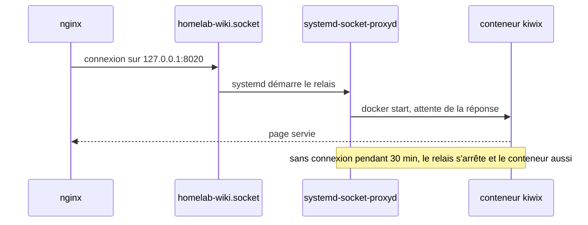
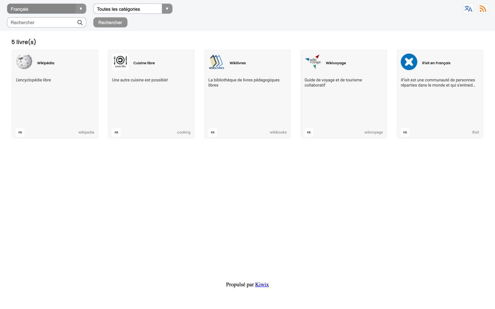
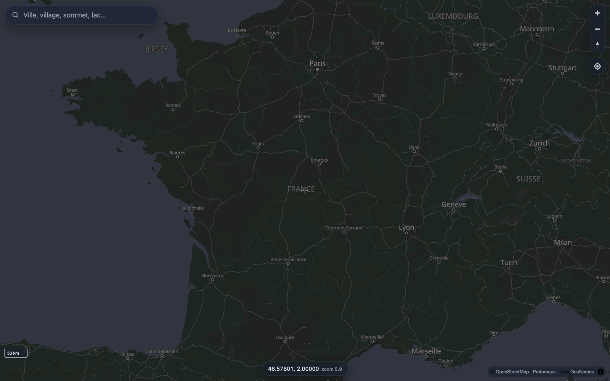

# Services

Toutes les adresses se terminent par `.exemple.duckdns.org`. Elles répondent dans l'appartement, et ailleurs sur un appareil connecté à Tailscale.

| Service | Adresse | Rôle | Fonctionnement |
|---|---|---|---|
| Homepage | racine du domaine | Page d'accueil avec tous les services et leurs capteurs | Permanent |
| Salle de contrôle | `noc.` | Supervision en direct : schéma du homelab, mesures, réseau, plan d'adressage | Permanent, page statique |
| Home Assistant | `ha.` | Domotique, avec AdGuard Home | Machine virtuelle |
| Immich | `photos.` | Photos et vidéos, sauvegarde automatique depuis l'iPhone | Permanent, version figée |
| Nextcloud | `cloud.` | Fichiers, agenda, contacts | À la demande |
| Stirling-PDF | `pdf.` | Outils PDF : fusionner, compresser, signer, convertir | À la demande |
| IT-Tools | `outils.` | Encodages, hachages, QR codes, outils réseau | Permanent |
| Kiwix | `wiki.` | Wikipédia en français et autres bibliothèques, hors ligne | À la demande |
| llama.cpp | `ia.` | IA conversationnelle sur le processeur du Pi | À la demande |
| Jellyfin | `films.` | Médiathèque personnelle | À la demande |
| Cartes | `cartes.` | Carte de France et recherche de lieux, hors ligne | Site statique |
| Uptime Kuma | `status.` | 31 sondes, page de statut, alertes | Permanent |
| ntfy | `ntfy.` | Notifications vers l'iPhone | Permanent |
| NetAlertX | `reseau.` | Inventaire des appareils du réseau, alerte si un inconnu se connecte | Permanent |
| Dozzle | `logs.` | Journaux des conteneurs, en lecture seule | Permanent |
| Portainer | `portainer.` | Gestion des conteneurs | Permanent |
| Documentation | `doc.` | Documentation de l'installation, aussi copiée avec les sauvegardes | Permanent, page statique |

Les versions des images sont fixées dans chaque `compose.yaml` (liste dans [stacks/README.md](../stacks/README.md)).

Tous les conteneurs suivent les mêmes règles. Ils n'écoutent que sur `127.0.0.1`, derrière nginx. Ils ont une limite de mémoire, une politique de redémarrage et l'option `no-new-privileges`, et je retire les capacités Linux inutiles quand l'image le permet. Le socket Docker n'est jamais monté directement : Homepage, Dozzle, Glances et Uptime Kuma passent par un `socket-proxy` en lecture seule, et seul Portainer a un accès complet. Les bases de données sont sur des réseaux Docker internes sans accès à Internet, et les secrets sont passés par fichiers (`secrets:` de Docker Compose ou variables `_FILE`).

## Services à la demande

Cinq services sont rarement utilisés. Ils restent arrêtés et démarrent tout seuls quand je les ouvre :

| Service | Démarrage | Arrêt après | Mémoire |
|---|---|---|---|
| Nextcloud (base, cache, application, tâches de fond) | environ 10 s | 30 min | environ 600 Mo |
| Stirling-PDF | environ 1 min | 15 min | environ 550 Mo |
| Kiwix | environ 2 s | 30 min | environ 50 Mo |
| IA locale | environ 2 s, plus 30 s au premier message pour charger le modèle | 15 min | de 30 Mo à 3 Go |
| Jellyfin | environ 15 s | 30 min | environ 400 Mo |

Les unités systemd correspondantes sont dans [systemd/](../systemd/). Il faut faire attention à ce que rien ne les réveille par erreur, donc Uptime Kuma ne les sonde pas et la page d'accueil lit leur état dans un fichier écrit par le Pi. Voir l'[ADR 0005](adr/0005-services-demarres-a-la-demande.md).

## Hors ligne

Kiwix sert cinq bibliothèques au format ZIM : Wikipédia en français (tous les articles, en texte, 12 Go), iFixit, Wikivoyage, Wikilivres et des recettes. On peut chercher dans tout le texte.

L'IA locale utilise llama.cpp en mode routeur, avec son interface web. J'ai trois modèles quantifiés en Q4_K_M, et un seul est chargé en mémoire à la fois :

| Modèle | Usage | Vitesse mesurée sur le Pi |
|---|---|---|
| Qwen3.5 4B | Questions, explications, rédaction | environ 2,7 jetons par seconde |
| Qwen3.5 2B | Réponses courtes | environ 5 jetons par seconde |
| Qwen2.5-Coder 3B | Code | environ 4,5 jetons par seconde |

Je les ai choisis avec [llmfit](https://github.com/AlexsJones/llmfit). Avec 3,7 Go de mémoire libre et sans carte graphique, un modèle de 4 milliards de paramètres est le plus gros qui tient en bonne qualité. Les vitesses annoncées par l'outil étaient environ 2,5 fois trop optimistes, celles du tableau sont mesurées. J'ai coupé le mode « réflexion » des modèles, qui faisait attendre plusieurs minutes, et le conteneur a une priorité processeur basse pour ne pas ralentir le reste.

La carte est une page MapLibre servie par nginx, sans aucun processus derrière. Elle utilise un fichier PMTiles de 9,8 Go (OpenStreetMap via Protomaps) lu par requêtes de plages HTTP, des polices et icônes en local et une recherche sur 90 000 lieux (GeoNames).

Pour Jellyfin, les fichiers sont en H.264 et AAC, lisibles tels quels sur tous les appareils. Le Pi 5 n'a pas d'encodeur vidéo matériel et ne pourrait pas convertir en direct.

Ces contenus téléchargeables (environ 34 Go) ne sont pas dans les sauvegardes hors site. [`homelab-survie`](../scripts/homelab-survie) les retélécharge après une restauration et les met à jour.

## Services retirés

| Service | Retiré le | Raison |
|---|---|---|
| Plex | 2026-11-02 | Je ne m'en servais pas. Jellyfin l'a remplacé le lendemain, sans compte externe. |
| n8n | 2026-11-01 | Je ne m'en servais pas. Son seul flux, le bulletin du matin, est devenu une automatisation Home Assistant. |
| Beszel | 2026-11-01 | Je ne m'en servais pas, Glances et la salle de contrôle suffisent. |
| Vaultwarden | 2026-11-01 | Je ne m'en servais pas. |
