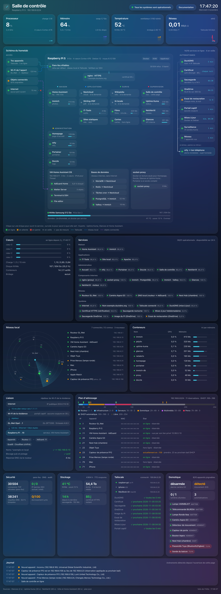

# Supervision et alertes

| Outil | Ce qu'il surveille | Où le voir |
|---|---|---|
| Uptime Kuma | 31 sondes chaque minute : pages web, conteneurs internes, appareils du réseau, DNS, Internet, tâches planifiées | `status.` |
| Glances | Processeur, mémoire, températures, disque, réseau, conteneurs | API interne lue par les autres pages |
| NetAlertX | Appareils du réseau de l'appartement, alerte quand un inconnu se connecte | `reseau.` |
| Salle de contrôle | Vue d'ensemble faite maison | `noc.` |
| Homepage | Page d'accueil avec un capteur par service | racine du domaine |
| Home Assistant | Tableau « Homelab », alertes de température et de mémoire | `ha.` |
| Lynis | Audit de sécurité chaque nuit à 00:30 | Score dans la salle de contrôle |

## Uptime Kuma

Les sondes sont rangées par groupes, comme sur la page de statut :

| Groupe | Sondes |
|---|---|
| Maison | Home Assistant, Immich |
| Applications | IT-Tools, sites statiques |
| Administration | Page d'accueil, ntfy, Portainer, Dozzle, salle de contrôle, NetAlertX |
| Composants internes | nginx, socket-proxy, bases de données d'Immich, Glances, moteur de NetAlertX |
| Réseau | Routeur, caméra, Nest Hub, DNS local |
| Système | Internet, nom public, Tailscale, DuckDNS, certificat HTTPS, sauvegardes, mises à jour, essai de restauration |

Pour les tâches planifiées, j'utilise des sondes de type « push ». Quand une tâche réussit, elle envoie un signal avec [`homelab-kuma-push`](../scripts/homelab-kuma-push), appelé par un `ExecStartPost` dans un fichier `kuma.conf` à côté de l'unité systemd. Sans signal dans le délai prévu, la sonde passe en panne, que la tâche ait échoué ou qu'elle ne se soit jamais lancée.

L'essai de restauration n'a lieu qu'une fois par mois, alors que Kuma limite l'intervalle d'une sonde à 24 jours. Sa sonde attend donc 20 jours, puis laisse encore 15 jours avant d'alerter.

Les services à la demande ne sont pas sondés, sinon ils seraient réveillés chaque minute.

## Salle de contrôle

C'est une page HTML et JavaScript sans dépendance ([stacks/proxy/site/noc/](../stacks/proxy/site/noc/)), servie par nginx. Elle lit l'API de Glances toutes les 2 secondes, l'état des sondes Kuma toutes les 30 secondes et les appareils vus par NetAlertX toutes les minutes. Elle lit aussi `hote.json`, écrit chaque minute par [`homelab-noc`](../scripts/homelab-noc) (pare-feu, sauvegardes, certificat, SSD, AdGuard, tâches planifiées, liaison réseau, portail captif, domotique), et [`plan.json`](../stacks/proxy/site/noc/plan.json) pour le plan d'adressage.

Le schéma du homelab affiche chaque élément avec un voyant : vert en ligne, orange en attente, rouge en panne, gris en veille. Les liaisons sont dessinées en SVG à partir de la position des éléments. Un clic ouvre le service et le survol explique à quoi il sert. Le reste de la page montre les cœurs du processeur, la disponibilité des sondes sur 24 heures, un radar des appareils du réseau, la liaison jusqu'à Internet, le plan d'adressage, la sécurité, le stockage, Tailscale et la domotique.

Sur la page d'accueil (Homepage), chaque tuile a un capteur : le widget du service quand il en existe un, le temps de réponse pour ce qui tourne en permanence, ou l'état et la consommation du conteneur. Pour les services en veille, les chiffres viennent de `accueil.json`, que `homelab-noc` écrit à partir du disque et de Docker, pour qu'afficher la page ne réveille aucun service.

## Alertes

Toutes les alertes passent par ntfy, hébergé sur le Pi, dans un seul sujet. L'application ntfy de l'iPhone les reçoit par le relais `ntfy.sh`, et le contenu n'est lisible qu'à travers Tailscale. Il n'y a que deux niveaux (voir l'[ADR 0007](adr/0007-alertes-sur-deux-niveaux.md)) :

| Niveau | Déclencheurs |
|---|---|
| Critique, avec son | Panne de Home Assistant, Immich, nginx, du DNS, de la caméra ou de Tailscale ; certificat ; sauvegarde locale, sauvegarde hors site, image disque ou essai de restauration en échec ; Pi au-dessus de 75 °C pendant 5 min ; mémoire au-dessus de 92 % pendant 10 min ; appareil inconnu sur le réseau ; plafond de stockage des sauvegardes ; compte refusé par le portail captif |
| Silencieux | Les autres sondes et les retours à la normale, l'échec des mises à jour, le bulletin du matin, une nouvelle version d'Immich, un essai de restauration réussi, une reconnexion au portail captif |
| Aucune | Connexions et déconnexions d'appareils connus, services en veille |

Une nouvelle sonde Kuma est silencieuse par défaut. Quand une tâche planifiée échoue, [`homelab-alerte@.service`](../systemd/homelab-alerte@.service) est lancé par `OnFailure=` et envoie les dernières lignes de son journal avec le bon niveau.

Quand Internet est coupé, aucune notification ne peut partir, puisque ntfy a besoin du relais `ntfy.sh` pour joindre l'iPhone. Les coupures du portail captif sont donc passées inaperçues sur le moment. Depuis, le script de reconnexion note chaque coupure et envoie un résumé dès qu'Internet revient.
