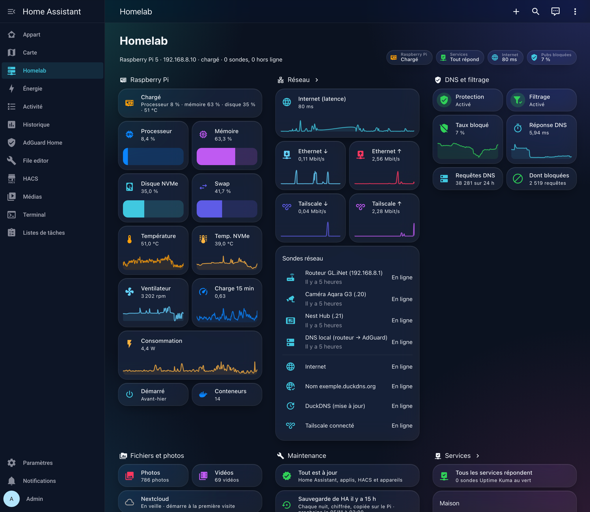

# Home Assistant

Home Assistant OS tourne dans une machine virtuelle sur le Pi ([ADR 0003](../docs/adr/0003-home-assistant-os-en-machine-virtuelle.md)). Sa configuration est écrite en YAML, dans `/config/` à l'intérieur de la VM.

Je ne publie que le tableau de bord « Homelab », qui concerne le Pi. Le reste de la configuration (pièces, appareils, automatisations) reste privé.

| Fichier | Contenu |
|---|---|
| [`dashboards/homelab.yaml`](dashboards/homelab.yaml) | Santé du Pi, réseau, DNS, sauvegardes, services et conteneurs |

Le tableau utilise les modules HACS Mushroom, card-mod et auto-entities. Ses données viennent des intégrations Glances (mesures du Pi et conteneurs), Uptime Kuma (état des sondes) et AdGuard Home (DNS).
